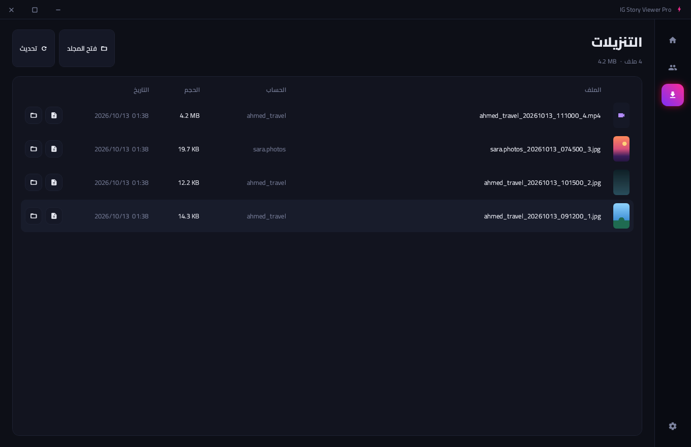

# IG Story Viewer Pro

A Windows desktop app (WPF, .NET 8) for viewing and downloading Instagram stories with **your own account**. It has a right-to-left Arabic interface with a dark "neon dashboard" design.


## Download
Get [`release/win-x64/InstagramStoryViewer.exe`](release/win-x64/InstagramStoryViewer.exe) and double-click it.
It's a single self-contained file, so .NET doesn't need to be installed (Windows 10/11, 64-bit).

## Features
- **Dashboard:** stats (accounts with stories, new stories, downloads, session status), a table of the selected account's stories, and a preview panel that plays images and videos.
- **Following:** every account you follow that currently has stories. The gradient ring means there are stories you haven't seen yet.
- **Search** for any public account, or a private account you follow.
- **Downloads** at the highest available quality with a progress bar. Each file is saved to `<download folder>/<username>/`.
- **Mark as seen** for one story or for all of them. The app asks first, because your name will appear in the story owner's viewers list.
- **Downloads page** lists every downloaded file. You can open a file or show it in its folder.
- **Settings:** download folder, confirm before marking as seen, video autoplay, and log out.

| Following | Downloads |
|---|---|
|  |  |
| **Settings** | **Login** |
|  |  |

## Logging in
There are two ways to log in:
1. **"Log in via Instagram"** opens instagram.com inside the app in an embedded Edge WebView2 browser. Log in as usual, and the window closes on its own once the app reads the session cookie. Your password never passes through the app.
   WebView2 comes preinstalled on Windows 10/11. If it's missing, install the *Evergreen Runtime* from Microsoft.
2. **Paste the cookie manually:** in your browser, open `F12`, then **Application**, then **Cookies**, then `instagram.com`. Copy `sessionid`, and preferably `csrftoken` too, in this form: `sessionid=...; csrftoken=...`.

The session is saved encrypted with Windows DPAPI in `%AppData%\InstagramStoryViewer\settings.json`, so other Windows accounts can't read it.

## Project structure
```
InstagramStoryViewer.sln
src/
├── InstagramStoryViewer.Core/   # Instagram API: requests, response parsing, errors, downloads
├── InstagramStoryViewer.Gui/    # WPF interface (MVVM) → InstagramStoryViewer.exe
│   ├── Views/                   # main window, WebView2 login window, dialogs
│   ├── ViewModels/              # app logic
│   ├── Themes/Theme.xaml        # colors and styles
│   └── Fonts/                   # Cairo + Material Icons (embedded in the app)
└── InstagramStoryViewer/        # command-line version (InstagramStoryViewer.Cli)
designs/                         # the five proposed interface designs
```

## Building from source
```bash
# development build
dotnet build InstagramStoryViewer.sln

# single-file exe
dotnet publish src/InstagramStoryViewer.Gui -c Release -r win-x64 -o release/win-x64

# command-line version
dotnet run --project src/InstagramStoryViewer -- --user natgeo --download
```
Building needs the .NET 8 SDK. It works on Windows, and also on Linux/macOS through `EnableWindowsTargeting`.

## Instagram endpoints used
| Purpose | Endpoint |
|---|---|
| Username to id | `GET /api/v1/users/web_profile_info/?username=` |
| Stories of followed accounts | `GET /api/v1/feed/reels_tray/` |
| A user's stories | `GET /api/v1/feed/reels_media/?reel_ids=` |
| Mark as seen | `POST /api/v1/stories/reel/seen` |

## Important notes
- These are unofficial Instagram endpoints and may change without notice.
- Using automated tools may violate Instagram's terms of use. Use the app reasonably and only for personal use. The app spaces out its requests to reduce the risk of restrictions on your account.
- Respect people's privacy, and don't republish other people's stories without their permission.
- Fonts: Cairo (OFL 1.1) and Material Icons (Apache 2.0). See `src/InstagramStoryViewer.Gui/Fonts/LICENSES.md`.
