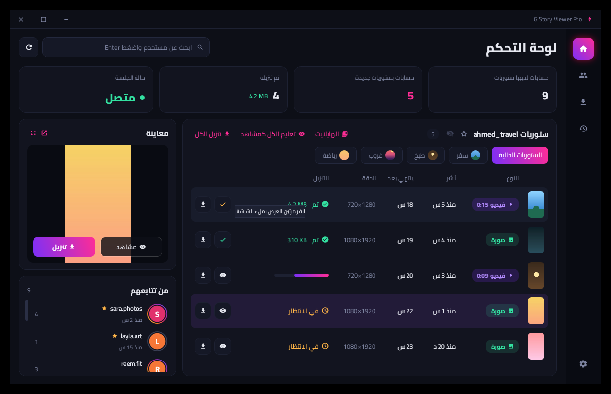
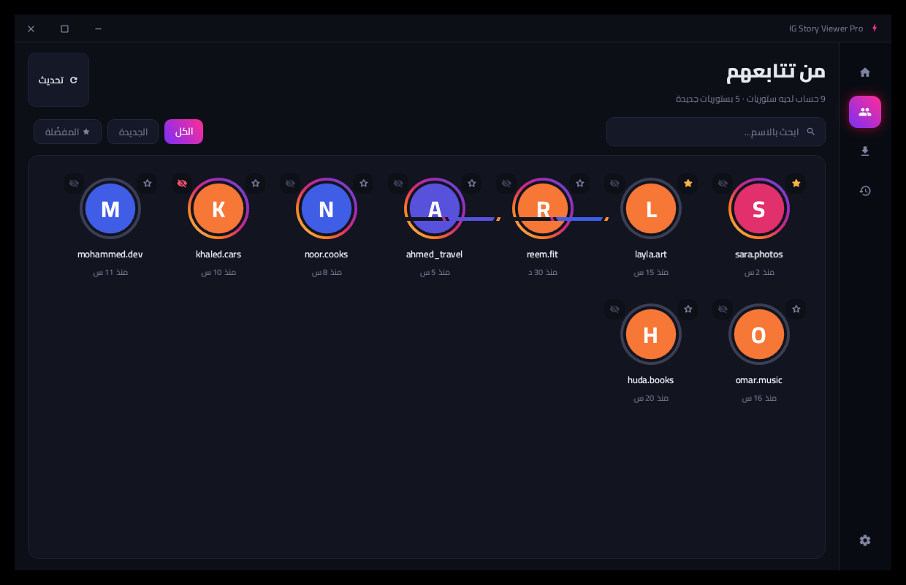
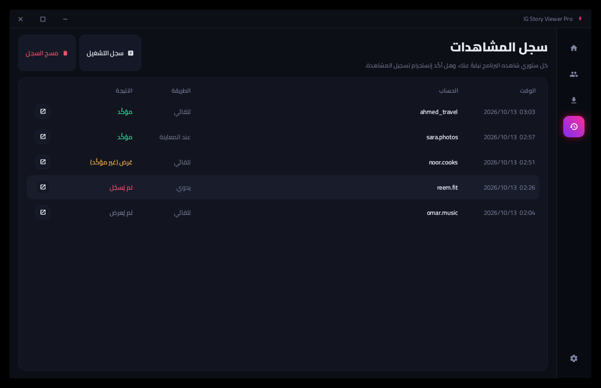
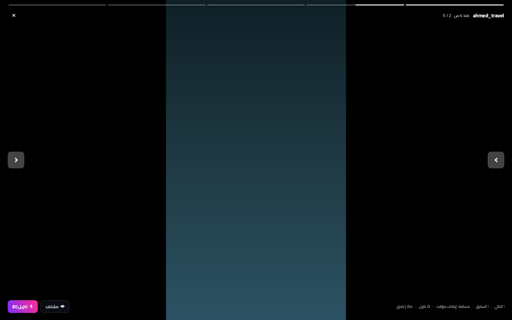
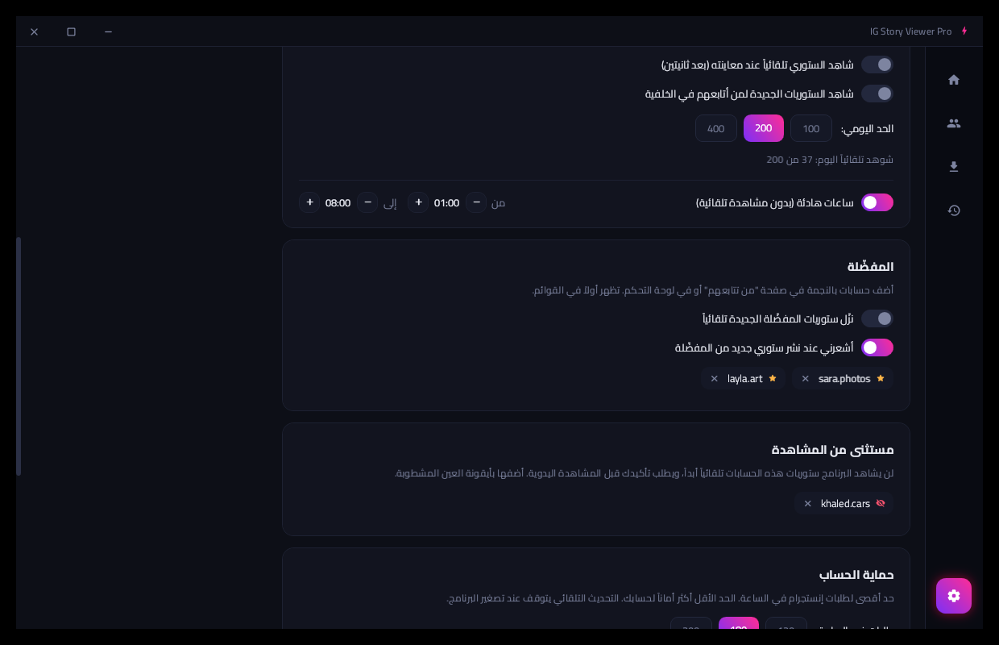
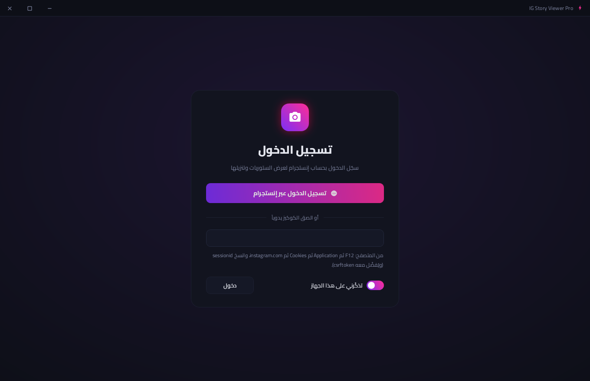

# IG Story Viewer Pro

A Windows desktop app (WPF, .NET 8) for viewing, downloading and watching Instagram stories with **your own account**.
The interface is in Arabic (right to left) with a dark "neon dashboard" design.



## Download
**[⬇ InstagramStoryViewer.exe (latest version)](https://github.com/6f8/Instagram/releases/latest/download/InstagramStoryViewer.exe)**. Every version is on the [Releases](https://github.com/6f8/Instagram/releases) page.

- It's a single self-contained file, so .NET doesn't need to be installed (Windows 10/11, 64-bit). Double-click to run it.
- Next to it is `InstagramStoryViewer.exe.sha256`, which you can use to verify the file (`Get-FileHash InstagramStoryViewer.exe` in PowerShell).
- The file isn't digitally signed, so Windows SmartScreen may warn you the first time: click **More info**, then **Run anyway**.
- The app checks for new versions daily and shows an update banner when one is available.

## Features

### Viewing and downloading
- **Dashboard:**
  - Stats at the top.
  - A table of the selected account's stories.
  - A preview panel that plays images and videos.
  - The list of accounts you follow.
- **Full-screen viewer:** double-click a story, or use the button in the preview panel.
  - Moves to the next story automatically.
  - Keys: `←` next, `→` previous, `Space` pause, `D` download, `Esc` close.
- **Highlights:** browse a profile's pinned stories and download them.
- **Downloads:** highest available quality.
  - Each file is saved to `<download folder>/<username>/`, and highlights to `<username>_highlights`.
  - Never downloaded twice, never saved incomplete.
  - Expired links are refreshed automatically.
- **Search** for any public account, or a private account you follow.

### Following and favorites
- Search by name, and filter: All, New, or Favorites.
- **Favorites ⭐:**
  - Starred accounts appear first.
  - Their new stories can be downloaded automatically.
  - You get a Windows notification when they post something new.

### Watching (marking as seen)
- **How it works:** the story actually plays in a small embedded-browser window in the corner of the screen, so Instagram records a real view.
- **Verification:** after watching, the app asks Instagram whether the view was recorded (**confirmed / unconfirmed / failed**).
- **Auto-watch (optional):**
  - When you preview a story.
  - Or your followed accounts' new stories, in the background.
  - Within a daily limit and outside **quiet hours** (default 01:00–08:00).
- **Exclusion list 👁‍🗨:** accounts the app never watches automatically. It asks before watching them manually.
- **Watch history:** everything the app watched for you, when, and the result.



| History | Full screen |
|---|---|
|  |  |
| **Settings** | **Login** |
|  |  |

### Protecting your account
- A cap on Instagram requests per hour (120/180/300), with random spacing between requests.
- Refreshes happen at irregular intervals and stop when the window is closed or minimized.
- Cookies that Instagram rotates are saved automatically, so the session doesn't expire on its own.
- A session that Instagram ends is detected immediately, and requests stop.
- The session is stored encrypted with Windows DPAPI.
- The diagnostics file and the log mask tokens and account identifiers.

### Running in the background
- Closing the window keeps the app running in the **notification area** next to the clock (Open / Refresh / Auto-watch / Quit).
- An option to **start with Windows**, minimized.
- Only one copy of the app runs at a time.

## Logging in
1. **"Log in via Instagram"** opens instagram.com inside the app (Edge WebView2). Log in as usual, and the window closes on its own. Your password never passes through the app.
   WebView2 comes preinstalled on Windows 10/11. If it's missing, install the *Evergreen Runtime* from Microsoft.
2. **Paste the cookie manually:** in your browser, open `F12`, then **Application**, then **Cookies**, then `instagram.com`, and copy `sessionid` (preferably with `csrftoken`).

## File locations
| What | Where |
|---|---|
| Settings and encrypted session | `%AppData%\InstagramStoryViewer\settings.json` (+ `.bak`) |
| Watch history | `%AppData%\InstagramStoryViewer\watch-history.jsonl` |
| Last unexpected server response (tokens masked) | `%AppData%\InstagramStoryViewer\last-response.txt` |
| Daily run log (7 days) | `%LocalAppData%\InstagramStoryViewer\logs\` |
| Embedded browser data | `%LocalAppData%\InstagramStoryViewer\WebView2\` |

## Project structure
```
InstagramStoryViewer.sln
src/
├── InstagramStoryViewer.Core/     # Instagram API: requests, response parsing, errors, downloads, log
├── InstagramStoryViewer.Gui/      # WPF interface (MVVM) → InstagramStoryViewer.exe
│   ├── Views/                     # main window, Pages/ (pages), full-screen viewer, watch window, login window
│   ├── ViewModels/                # MainViewModel split by function (Session, Stories, Downloads, Watch, Accounts, ...)
│   ├── Services/                  # settings, watch history, tray icon, startup with Windows, update check
│   ├── Themes/Theme.xaml          # colors, styles and shared templates
│   └── Fonts/                     # Cairo + Material Icons (embedded)
└── InstagramStoryViewer/          # command-line version
tests/InstagramStoryViewer.Tests/  # xUnit tests for the core library
.github/workflows/build.yml        # CI: tests + exe build; tags v* publish a Release
designs/                           # the five proposed interface designs
```

## Building from source
```bash
dotnet build InstagramStoryViewer.sln
dotnet test tests/InstagramStoryViewer.Tests
dotnet publish src/InstagramStoryViewer.Gui -c Release -r win-x64 -o out
```
To publish a new version: bump `<Version>` in `InstagramStoryViewer.Gui.csproj`, then push a tag such as `v2.3.0`. GitHub Actions builds the exe and adds it to Releases.

## Instagram endpoints used
| Purpose | Endpoint |
|---|---|
| Username to id | `GET /api/v1/users/web_profile_info/?username=` |
| Logged-in account info | `GET /api/v1/users/{id}/info/` |
| Stories of followed accounts | `GET /api/v1/feed/reels_tray/` |
| Stories of an account or highlight, or several accounts at once | `GET /api/v1/feed/reels_media/?reel_ids=..` |
| An account's highlights | `GET /api/v1/highlights/{id}/highlights_tray/` |
| Mark as seen | Plays the story in the embedded browser (the old REST endpoint returns 404) |

If `www.instagram.com` returns an HTML page instead of data, the app automatically tries `i.instagram.com`.

## Important notes
- These are unofficial Instagram endpoints, and they may change without notice.
- Using automated tools may violate Instagram's terms of use. Use the app reasonably and only for personal use.
- Respect people's privacy, and don't republish other people's stories without their permission.
- Fonts: Cairo (OFL 1.1) and Material Icons (Apache 2.0). See `src/InstagramStoryViewer.Gui/Fonts/LICENSES.md`.
